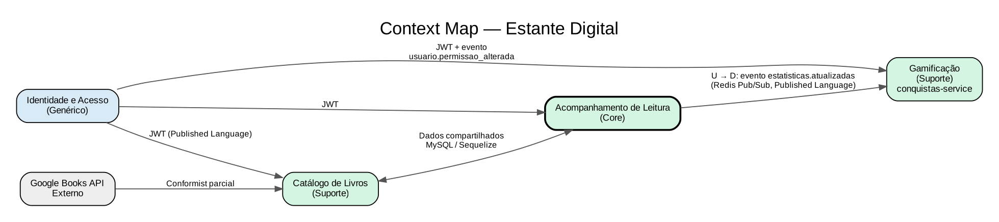

# Bounded Contexts

## Identidade e Acesso
**Responsabilidade:** cadastro, autenticação e autorização. Entidade principal: Usuário. O JWT é validado pelos dois serviços; o Express usa middleware de autenticação/admin e o NestJS usa guard global com `@Publica()`, `@ApenasAdmin()` e `@UsuarioAtual()`. Quando um usuário é promovido ou rebaixado, o evento `usuario.permissao_alterada` faz o NestJS recusar os tokens antigos (GDL-79).

## Catálogo de Livros
**Responsabilidade:** livros, autores, editoras e gêneros. Integra Google Books. `googleBooksService.ts` normaliza URLs de imagem; o mapeamento ainda usa a estrutura externa `volumeInfo`, sem ACL completa.

## Acompanhamento de Leitura (Core)
**Responsabilidade:** leituras por usuário, progresso, sessões, anotações, metas e avaliações. É o **publicador** de `estatisticas.atualizadas`: depois de cada escrita bem-sucedida, monta o snapshot das estatísticas do leitor (`eventos/estatisticasLeitor.ts`).

## Gamificação
**Responsabilidade:** catálogo de conquistas, critério, progresso e concessão. Fica inteiro no `conquistas-service` (NestJS), com schema próprio `gamificacao`. Entidades TypeORM: `Conquista`, `ConquistaDoUsuario`, `EstatisticasLeitorEntity`. Não consulta o banco do Express: recebe as estatísticas só pelo evento. O código antigo do Express foi removido (GDL-75).

## Limites de persistência
`projeto5p` e `gamificacao` são schemas separados no mesmo MySQL. `id_usuario` e `id_genero` no schema de gamificação são referências numéricas sem FK entre schemas.

