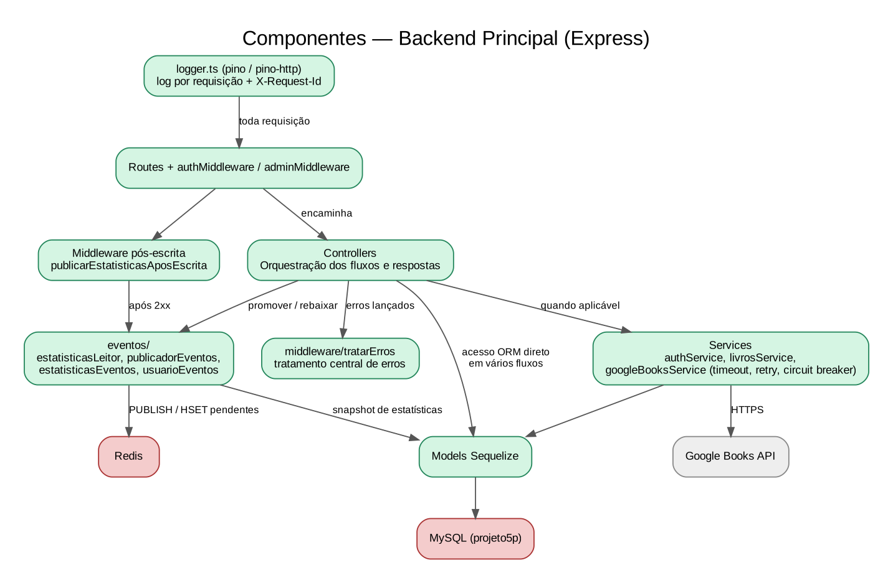

# Componentes do Backend Principal

Diagrama baseado na estrutura real do Express (`routes`, `controller`, `services`, `eventos`, `models-auto` e `logger.ts`).

## Separação de responsabilidades
- **logger.ts:** log estruturado por requisição e `X-Request-Id` (GDL-34).
- **Middlewares pós-escrita:** depois de uma escrita 2xx, publicam o evento de estatísticas.
- **eventos/:** monta o snapshot de estatísticas e publica no Redis; guarda pendentes quando ninguém assina.
- Controllers, services e models: nem todos os fluxos usam camadas de forma rígida; alguns controllers acessam modelos Sequelize diretamente (GDL-37).