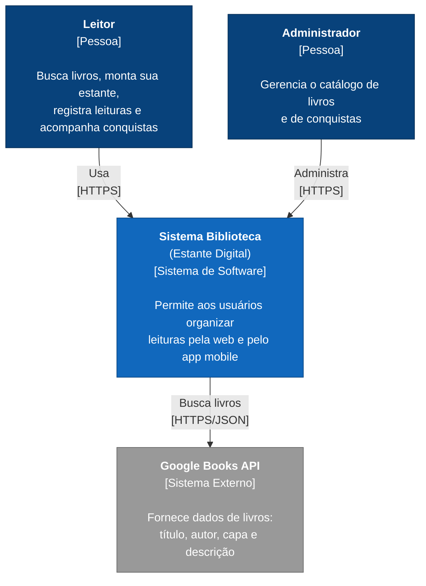

# Diagrama C4 — Nível 1: Contexto

Visão geral do sistema: quem o utiliza e com quais sistemas externos ele se comunica.

## Elementos

| Elemento | Tipo | Descrição |
|---|---|---|
| Leitor | Pessoa | Usuário que busca livros, organiza sua estante e acompanha conquistas pela web ou pelo app mobile. |
| Administrador | Pessoa | Usuário com permissão de admin que gerencia o catálogo de livros e de conquistas. |
| Sistema Biblioteca | Sistema de software | O sistema documentado aqui (frontend web, app mobile, backend e conquistas-service). |
| Google Books API | Sistema externo | API pública do Google consultada pelo backend para buscar dados de livros. |
