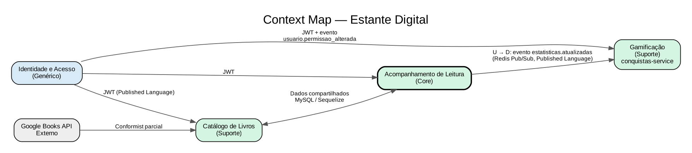

# Context Map

## Contextos

| Contexto | Papel | Responsabilidade | Onde |
|---|---|---|---|
| Identidade e Acesso | Genérico | Cadastro, JWT, perfil e autorização | Express |
| Catálogo de Livros | Suporte | Livros, autores, editoras, gêneros e Google Books | Express |
| Acompanhamento de Leitura | Core | Leituras, progresso, sessões, anotações, metas, avaliações | Express |
| Gamificação | Suporte | Critérios, catálogo, progresso e concessão de conquistas | conquistas-service (NestJS) |
| Google Books | Externo | Fonte de dados bibliográficos | API externa |

## Relações

| Upstream → Downstream | Padrão | Como |
|---|---|---|
| Acompanhamento → Gamificação | **Published Language + Customer/Supplier**, assíncrono | Evento `estatisticas.atualizadas` no Redis Pub/Sub com contrato fixo (`usuarioId`, `estatisticas`, `geradoEm`). O consumidor valida o formato e ignora evento inválido |
| Identidade → todos | **Published Language** | JWT com a mesma `JWT_SECRET`; `usuario.permissao_alterada` para revogação |
| Catálogo ↔ Acompanhamento | Dados compartilhados (não é Shared Kernel formal) | Mesmo banco/ORM; `ListarLivrosController` inclui leituras |
| Google Books → Catálogo | **Conformist parcial** | O backend usa `volumeInfo` e converte parte dos campos; sem ACL isolada |

