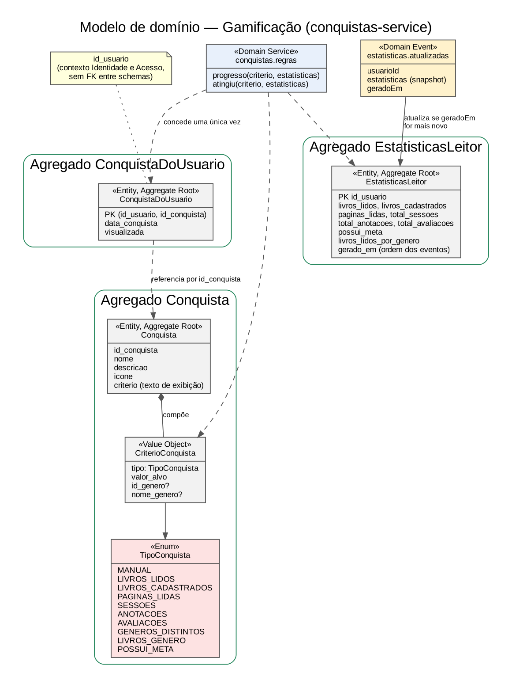

# Modelo de domínio — Gamificação

## Entidades
- **Conquista:** `id_conquista`, nome, descrição, ícone, texto de critério (exibição) e o critério estruturado.
- **ConquistaDoUsuario:** concessão ao leitor, PK composta `(id_usuario, id_conquista)` — a mesma conquista não é concedida duas vezes. Campo `visualizada` controla o aviso no app (GDL-72).
- **EstatisticasLeitor:** um registro por leitor com os números recebidos pelo evento e `gerado_em`, usado para descartar eventos atrasados (GDL-71).

## Value Objects e tipos
- `CriterioConquista`: `tipo`, `valor_alvo`, `id_genero` e `nome_genero` opcionais.
- `EstatisticasLeitor` (no evento): snapshot imutável de valores de entrada das regras.
- `TipoConquista`: MANUAL, LIVROS_LIDOS, LIVROS_CADASTRADOS, PAGINAS_LIDAS, SESSOES, ANOTACOES, AVALIACOES, GENEROS_DISTINTOS, LIVROS_GENERO e POSSUI_META.

## Aggregates
1. **Conquista:** raiz com dados e critério.
2. **ConquistaDoUsuario:** raiz do registro de concessão, com identidade composta; referencia Conquista só por id.
3. **EstatisticasLeitor:** raiz das estatísticas do leitor; só muda por evento mais novo.

## Domain Service e evento
- **Regras** (`conquistas.regras.ts`): funções puras de progresso e de critério atingido, cobertas por testes.
- **Domain Event** `estatisticas.atualizadas`: publicado pelo contexto de Acompanhamento; ao recebê-lo, o serviço atualiza `EstatisticasLeitor` (upsert condicional por `gerado_em`) e em seguida concede as conquistas atingidas; a inserção só acontece se a concessão ainda não existe (PK composta), então reprocessar o mesmo evento não duplica nada.