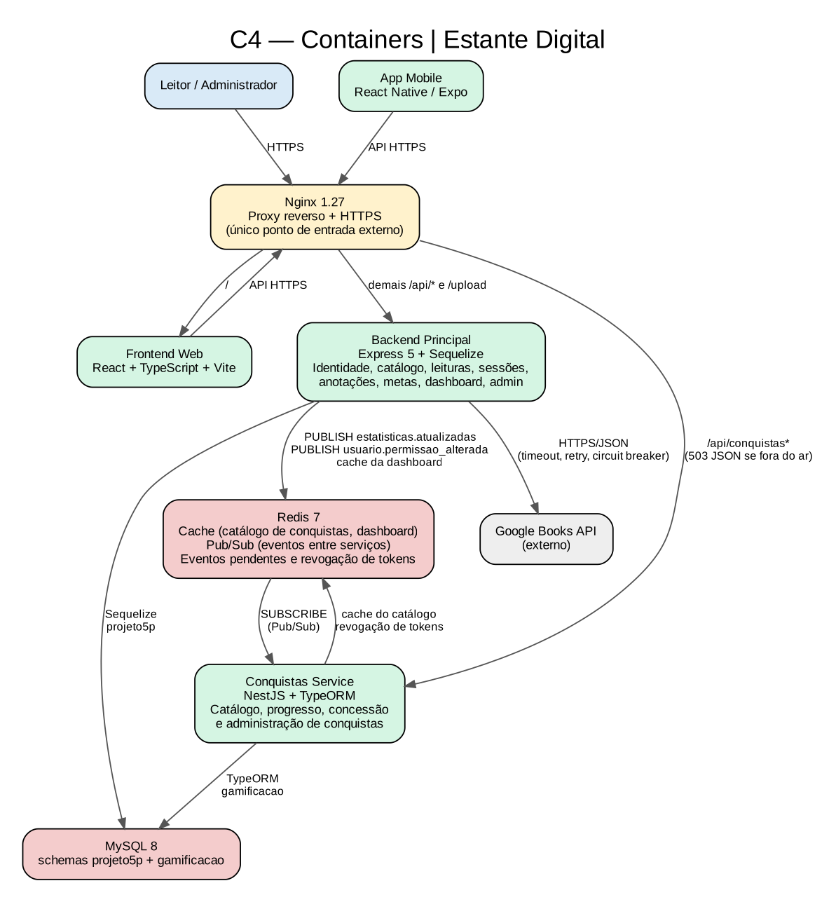

# Visão geral da arquitetura

## Objetivo
A Estante Digital permite organizar a biblioteca pessoal, acompanhar leituras, registrar sessões e anotações, definir metas e ganhar conquistas.

## Containers

| Container | Tecnologia | Responsabilidade | Situação |
|---|---|---|---|
| Frontend web | React + Vite | Interface web | No Compose |
| Mobile | Expo / React Native | Interface móvel; avisa conquistas novas | No repositório |
| Backend Principal | Express 5 + TypeScript + Sequelize | Identidade, catálogo, leituras, sessões, anotações, metas, dashboard, administração; **publica eventos** | No Compose |
| Conquistas Service | NestJS + TypeORM | Catálogo, progresso, concessão e administração de conquistas; **consome eventos** | No Compose, sem porta exposta |
| MySQL | MySQL 8 | Schemas `projeto5p` e `gamificacao` | No Compose (porta só em `127.0.0.1`) |
| Redis | Redis 7 | Cache, Pub/Sub, eventos pendentes, revogação de tokens | No Compose |
| Nginx | Nginx 1.27 Alpine | TLS local e proxy reverso; único ponto de entrada | No Compose |
| Google Books | API externa | Pesquisa de dados bibliográficos | Integração no backend |

## Roteamento
- `/api/conquistas` e subrotas → `conquistas-service:3001`. Se o serviço estiver fora, o Nginx responde **503 JSON**.
- Demais rotas `/api/` e `/upload` → `backend:3000`.
- `/` → `frontend:5173`.

## Comunicação entre os serviços (Redis Pub/Sub)
1. Toda escrita bem-sucedida do leitor em `/api/livros`, `/api/leituras`, `/api/anotacoes`, `/api/sessoes` ou `/api/metas` faz o Express calcular um **snapshot das estatísticas** do leitor e publicar `estatisticas.atualizadas` (GDL-70).
2. O Conquistas Service consome o evento, grava `estatisticas_leitor` (só se o `geradoEm` for mais novo), concede as conquistas atingidas uma única vez e invalida o cache do catálogo do leitor (GDL-71).
3. Se ninguém estava assinando (serviço fora do ar), o Express guarda o último snapshot do leitor no hash `eventos:pendentes:estatisticas.atualizadas`; o Nest processa o hash ao subir e a cada 30 s (GDL-76).
4. O app chama `GET /api/conquistas/novas` logo depois das escritas (0,8 s e 2,5 s) e mostra a celebração (GDL-72).
5. Promover/rebaixar usuário publica `usuario.permissao_alterada`; o Nest recusa (401) tokens emitidos antes da mudança (GDL-79).

O código antigo de conquistas do Express foi removido (GDL-75): a extração da Gamificação está concluída.

## Persistência
Os dois schemas ficam no mesmo servidor MySQL, com credenciais distintas. O isolamento é lógico, não físico. `id_usuario` e `id_genero` no schema de gamificação não têm FK para o schema principal; por isso a conquista guarda também `nome_genero` (GDL-69).

## Observabilidade
Erros lançados passam por um tratamento central nos dois serviços e saem como `{ erro, statusCode }` (filtro global no NestJS; middleware no Express, GDL-35 — alguns controllers antigos do Express ainda montam a própria resposta 500). Os dois serviços usam logger estruturado (pino): uma linha por requisição com `reqId`, usuário, status e duração; cabeçalho `X-Request-Id`; logs de publicação e consumo de eventos e de cache. Ver [observabilidade](../operacao/observabilidade.md).

## Riscos e limites
- Controllers Express ainda acessam modelos Sequelize diretamente em vários fluxos (GDL-36 e GDL-37 no backlog).
- `ListarLivrosController` inclui leituras do usuário para filtrar/apresentar o catálogo.
- Dados do Google Books podem vir sem páginas ou gênero (ver QS-13).
- Redis Pub/Sub entrega no máximo uma vez; a perda é coberta pelo snapshot cumulativo e pelo hash de pendentes, não por fila persistente.