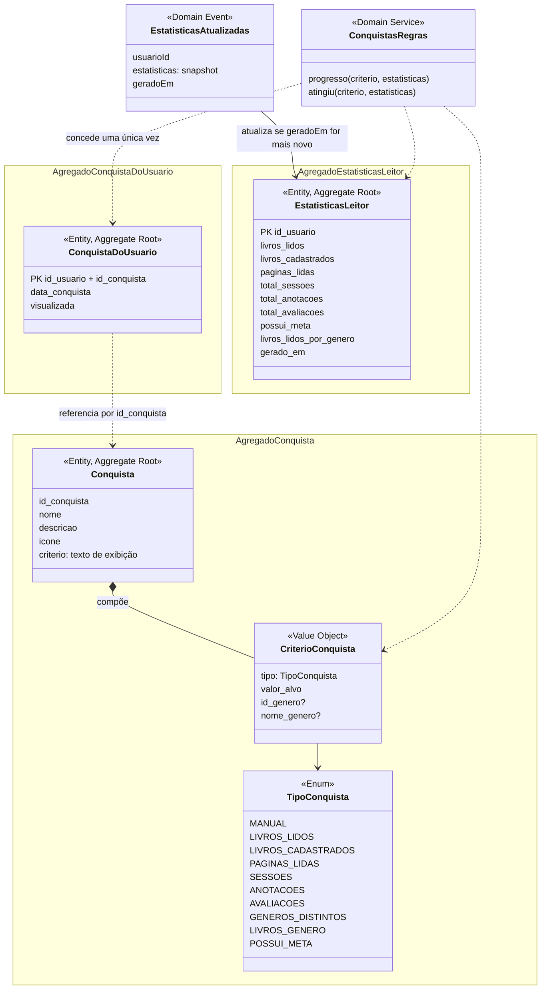

# Modelo de domínio — Gamificação (conquistas-service)

- `id_usuario` pertence ao contexto Identidade e Acesso (sem FK entre schemas).
- Explicação de cada elemento em [arquitetura/modelo-dominio-gamificacao.md](../arquitetura/modelo-dominio-gamificacao.md).
